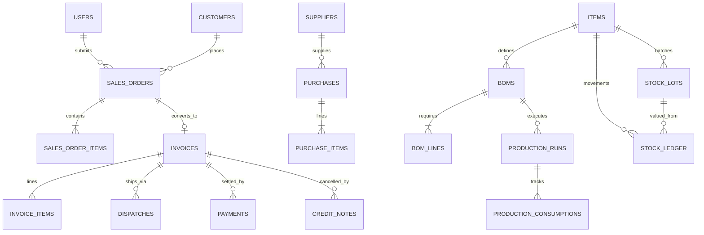

# Design Note: Order-to-Audit System for a Small Food Manufacturer

## 1. Architecture & Data Model

The system links the **Sales Loop** and **Production Loop** at **Finished-Goods Inventory**, backed by an append-only `stock_ledger` and lot table `stock_lots` in SQLite. All monetary values use **integer paisa** (`1 ₹ = 100 paisa`), quantities use **integer milli-base-units** (`1/1000` of `g`, `ml`, `piece`, `packet`), and rates/variances use **basis points** (`1% = 100 bps`).

### Key Design Principles
1. **No Mutable Stock Column:** Current stock for any raw material, packaging item, or finished good is always derived as `SUM(qty_delta_milli)` from `stock_ledger`.
2. **Full Document Traceability:** Every ledger row references `source_type` (`SEED`, `PURCHASE`, `PRODUCTION_RUN`, `DISPATCH`, `CREDIT_NOTE`) and `source_ref` (`PUR/...`, `RUN/...`, `DSP/...`).
3. **Immutable Audit Trail:** Edits to orders, overhead allocations, and invoice cancellations (via Credit Notes, never deletes) write before/after snapshots to `audit_logs` with user ID, role, and timestamp.
4. **Offline-Safe Field Orders:** Mobile salesman orders carry a client-generated `client_offline_id` (`UNIQUE`), ensuring retries or batch syncs are idempotent.

---

## 2. Stock, Unit Conversion & BOM Consumption Logic

### Unit Conversion
Every item defines a canonical `base_unit` (`g`, `ml`, `piece`, `packet`) and a `display_factor_milli` (`1,000,000` for `kg`/`L`; `1,000` for `g`/`ml`/`piece`/`packet`).
- `40 kg` Flour → `40 × 1,000,000 = 40,000,000` milli-g.
- `10.5 L` Cooking Oil → `10.5 × 1,000,000 = 10,500,000` milli-ml.
- `1 carton` of Murukku 200 g → `packets_per_carton × 1,000 = 20,000` milli-packets.

### Two-Stage Production Execution & Variance
1. **Run Start (`PROD_ISSUE`):** For each raw material in the BOM, `planned = qty_per_batch × batch_multiplier`. The supervisor records actual issued quantities (e.g., `10.5 L` oil vs `10 L` planned). Raw material lots are consumed in **FEFO/FIFO** order (`ORDER BY expiry_date ASC, received_date ASC, id ASC`).
2. **Run Completion (`PROD_ISSUE` packaging + `PROD_OUTPUT` finished goods):** Actual good packets (`188`), damaged pouches (`6`), and cartons (`9`) are entered. Total pouches consumed (`188 + 6 = 194`) and cartons (`9`) are deducted from packaging stock, and `+188 packets` are added as a new finished-goods lot.
3. **Variance Flagging:**
   $$\text{Variance (bps)} = \text{round}\left(\frac{\text{Actual} - \text{Planned}}{\text{Planned}} \times 10000\right)$$
   Any material consumption or yield variance exceeding `±300 bps` (`±3.00%`) sets `is_flagged = 1` and raises `has_variance_alert = 1` on the run and owner dashboard.

---

## 3. Costing, Valuation & GST Rules

- **Valuation Method (FIFO / FEFO):** Selected because packaged food manufacturing naturally follows First-Expiry-First-Out / First-In-First-Out physical flow, and FIFO keeps lot costs exact without fractional-paisa drift across mixed purchase rates.
  - Benchmark material cost: `40 kg Flour @ ₹42 (₹1,680) + 10.5 L Oil @ ₹140 (₹1,470) + 1.2 kg Spice @ ₹200 (₹240) + 194 Pouches @ ₹2.50 (₹485) + 9 Cartons @ ₹15 (₹135) = ₹4,010.00`.
- **Overhead Rule:** Direct batch allocation of Labour (`₹1,200`) + Gas/Power (`₹600`) = `₹1,800.00` divided by actual good packets (`188`), yielding:
  $$\text{Cost per Packet} = \frac{₹4,010 + ₹1,800}{188} = ₹30.90 \quad (\text{Margin: } ₹19.10 / 38.2\% \text{ at } ₹50\text{ selling price})$$
- **GST Place-of-Supply Math:** Comparing `customer.state_code` against `factory.state_code` (`33` Tamil Nadu):
  - Same state (`33 == 33`, Retailer A): `CGST 2.5%` + `SGST 2.5%` (`₹7,500 + ₹187.50 + ₹187.50 = ₹7,875.00`).
  - Different state (`29 != 33`, Distributor B): `IGST 5%`. Stock insufficiency (`88 < 120`, short `32 packets`) blocks approval with HTTP `409` while surfacing the shortage and IGST preview.
